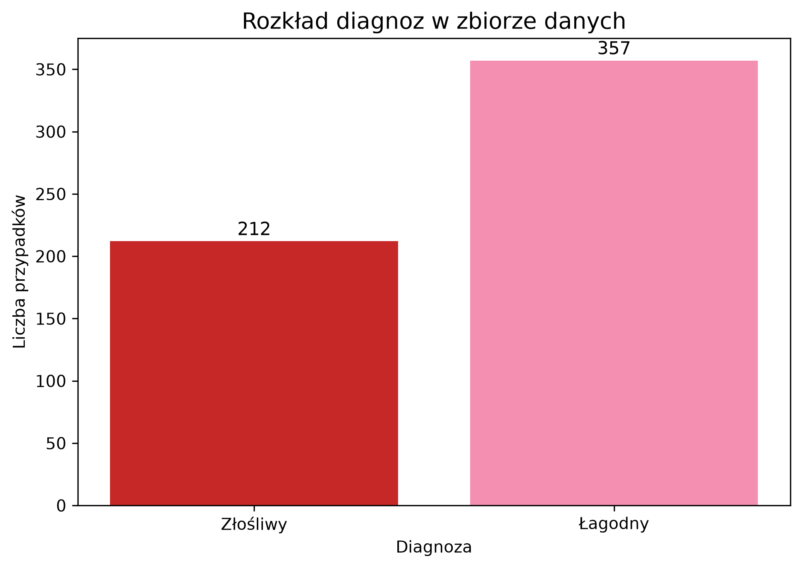
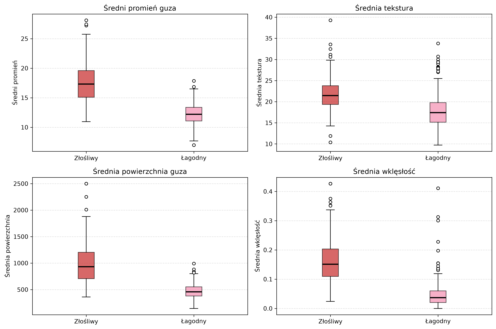
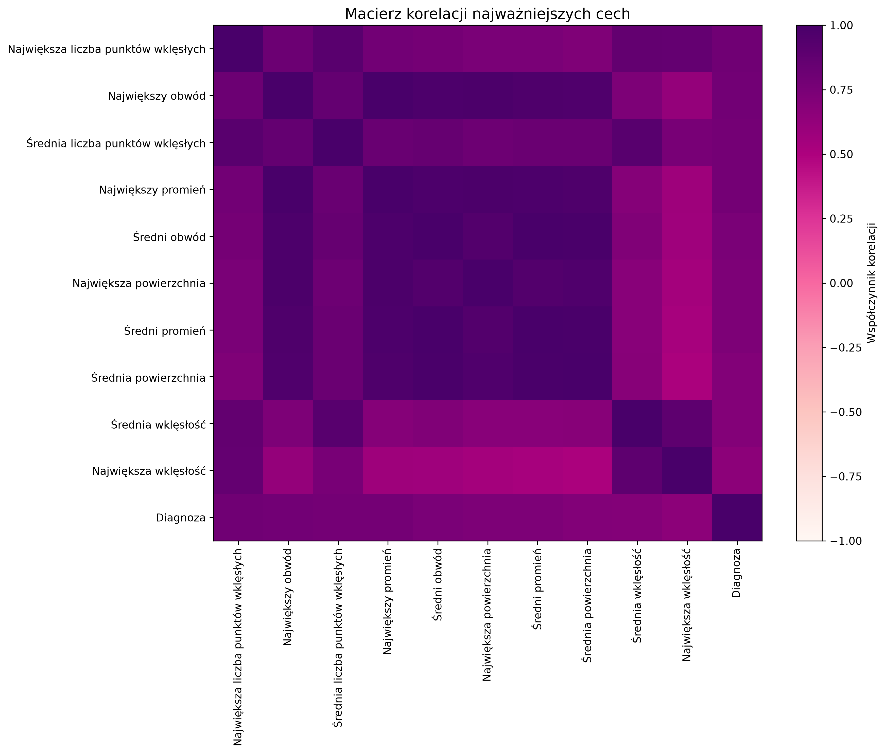
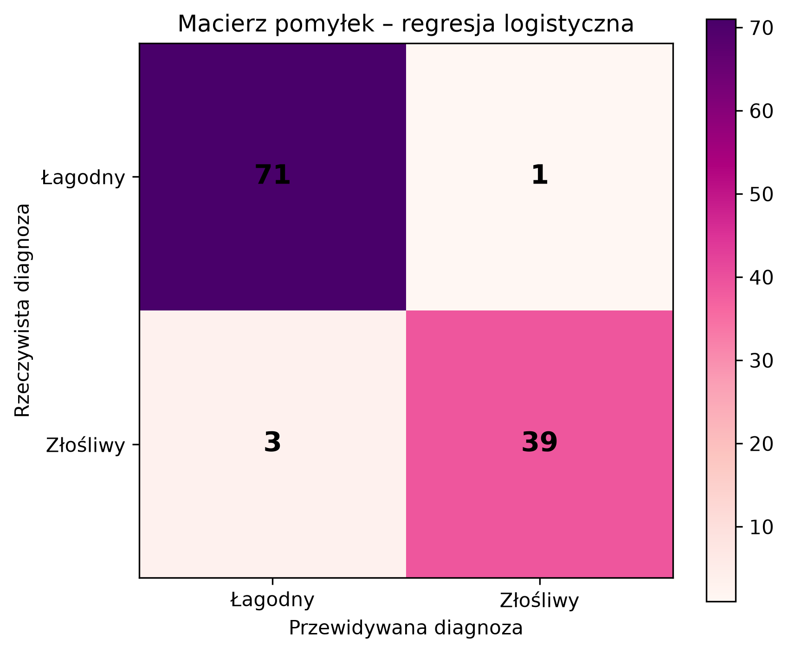
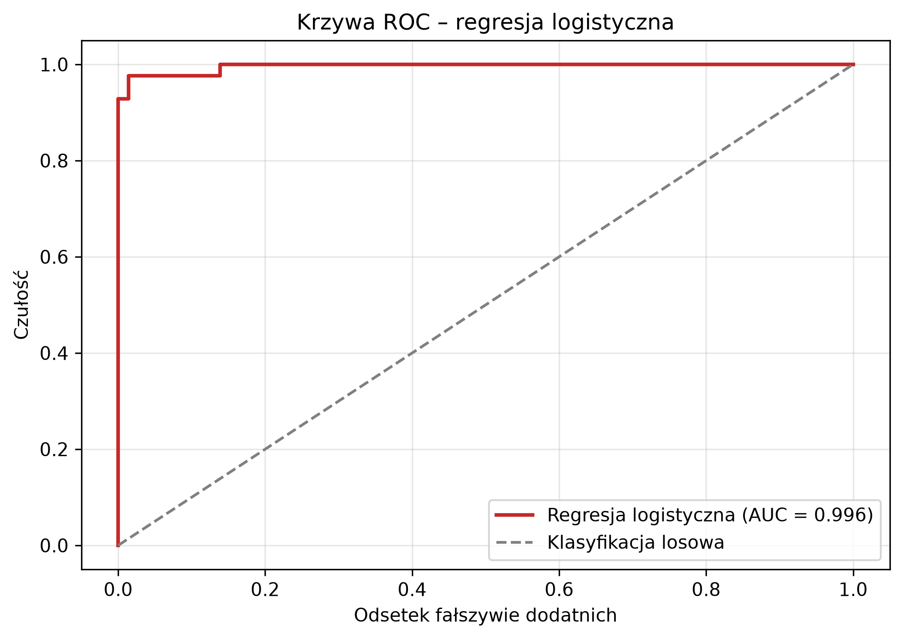
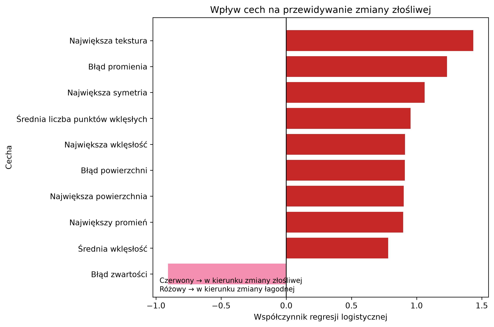
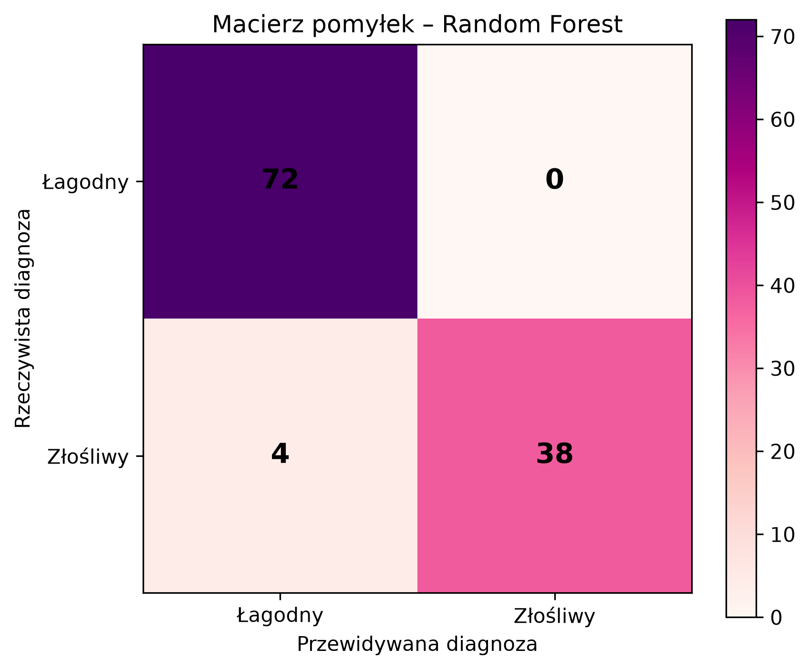
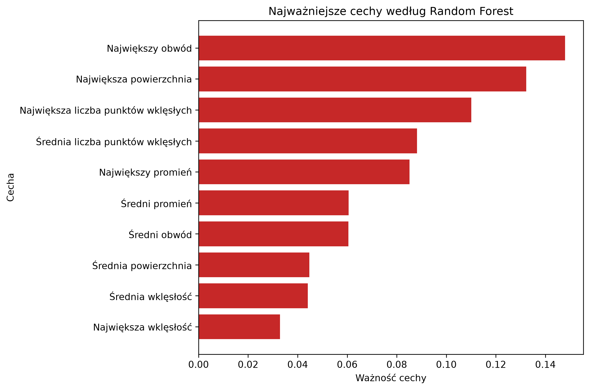
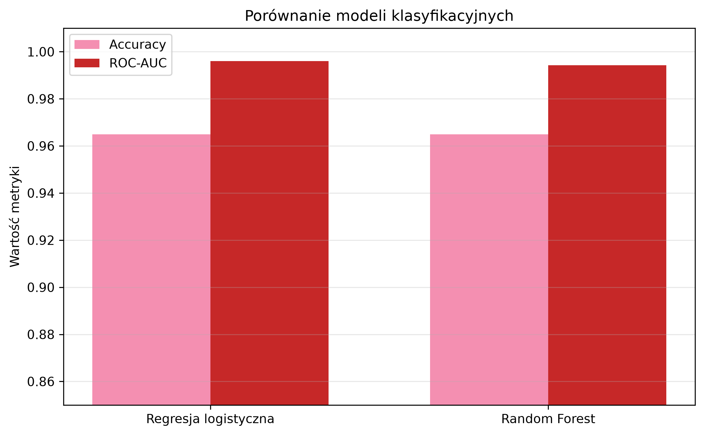

# Wspomaganie diagnostyki raka piersi 

## O projekcie

Projekt przedstawia zastosowanie metod uczenia maszynowego do klasyfikacji zmian piersi jako **łagodnych** lub **złośliwych** na podstawie danych diagnostycznych.

Celem analizy jest sprawdzenie, czy na podstawie cech opisujących właściwości komórek możliwe jest skuteczne rozróżnienie obu rodzajów zmian oraz które cechy mają największe znaczenie dla predykcji modelu.

Projekt obejmuje eksploracyjną analizę danych, analizę zależności pomiędzy cechami, budowę dwóch modeli klasyfikacyjnych oraz porównanie ich skuteczności.

---

## Zbiór danych

W projekcie wykorzystano zbiór **Breast Cancer Wisconsin (Diagnostic)** dostępny w bibliotece `scikit-learn`.

Zbiór zawiera:

- **569 obserwacji**,
- **30 cech numerycznych**,
- dwie klasy diagnozy:
  - zmiana łagodna,
  - zmiana złośliwa.

Cechy opisują właściwości jąder komórkowych, między innymi ich:

- promień,
- teksturę,
- obwód,
- powierzchnię,
- gładkość,
- zwartość,
- wklęsłość,
- symetrię.

W zbiorze nie występują brakujące wartości.

Na potrzeby modeli przyjęto:

- `0` – zmiana łagodna,
- `1` – zmiana złośliwa.

---

## Wykorzystane technologie

- Python
- Pandas
- NumPy
- Matplotlib
- Scikit-learn

---

# Eksploracyjna analiza danych

Pierwszym etapem projektu była analiza struktury zbioru oraz sprawdzenie różnic pomiędzy zmianami łagodnymi i złośliwymi.

## Rozkład diagnoz

Poniższy wykres przedstawia liczbę obserwacji należących do obu klas.



W zbiorze znajduje się więcej przypadków zmian łagodnych niż złośliwych. Różnica nie jest jednak na tyle duża, aby jedna z klas całkowicie dominowała nad drugą.

Podczas podziału danych na zbiór treningowy i testowy zastosowano stratyfikację, aby zachować podobne proporcje obu klas.

---

## Porównanie wybranych cech

W kolejnym kroku porównano rozkłady czterech wybranych cech:

- średniego promienia,
- średniej tekstury,
- średniej powierzchni,
- średniej wklęsłości.



Na wykresach widoczne są wyraźne różnice pomiędzy zmianami łagodnymi i złośliwymi.

Zmiany złośliwe charakteryzują się przeciętnie:

- większym promieniem,
- większą powierzchnią,
- większą wklęsłością,
- wyższymi wartościami części pozostałych cech morfologicznych.

Przykładowo średnia powierzchnia zmian złośliwych jest znacznie większa niż średnia powierzchnia zmian łagodnych.

Wskazuje to, że część cech może mieć dużą wartość predykcyjną podczas klasyfikacji.

---

## Analiza korelacji

Aby sprawdzić, które zmienne są najsilniej związane z diagnozą, obliczono współczynniki korelacji pomiędzy cechami.

Następnie wybrano 10 cech wykazujących najsilniejszą zależność ze zmienną docelową.



Do cech silnie związanych z diagnozą należą między innymi:

- największy obwód,
- największy promień,
- największa powierzchnia,
- średnia liczba punktów wklęsłych,
- największa liczba punktów wklęsłych,
- średnia wklęsłość.

Macierz pokazuje również silne zależności pomiędzy niektórymi cechami, szczególnie tymi opisującymi rozmiar zmiany.

---

# Przygotowanie danych

Dane podzielono na:

- **80% – zbiór treningowy**,
- **20% – zbiór testowy**.

Zastosowano `random_state=42`, aby wyniki eksperymentu były powtarzalne.

Podział został wykonany ze stratyfikacją, dzięki czemu proporcja zmian łagodnych i złośliwych została zachowana w obu zbiorach.

Dla regresji logistycznej wykonano dodatkowo **standaryzację cech** przy użyciu `StandardScaler`.

Skaler został dopasowany wyłącznie do zbioru treningowego, a następnie wykorzystany do transformacji zbioru testowego.

---

# Modele klasyfikacyjne

W projekcie porównano dwa algorytmy uczenia maszynowego:

1. **regresję logistyczną**,
2. **las losowy (Random Forest)**.

Do oceny modeli wykorzystano kilka metryk, ponieważ sama dokładność nie jest wystarczająca do oceny problemu klasyfikacji medycznej.

Analizowano:

- **dokładność** – odsetek wszystkich poprawnych klasyfikacji,
- **czułość dla zmian złośliwych** – odsetek rzeczywiście złośliwych zmian poprawnie wykrytych przez model,
- **ROC-AUC** – miarę zdolności modelu do rozróżniania obu klas,
- **macierz pomyłek** – pokazującą rodzaje popełnianych przez model błędów.

---

# Regresja logistyczna

Regresja logistyczna została wytrenowana na standaryzowanych danych.

Uzyskane wyniki:

| Metryka | Wynik |
|---|---:|
| Dokładność | **98,25%** |
| ROC-AUC | **0,9954** |
| Czułość dla zmian złośliwych | **98,61%** |

## Macierz pomyłek



Macierz pomyłek pokazuje, ile przypadków zostało zaklasyfikowanych poprawnie, a ile błędnie.

Szczególnie istotne w tym problemie są przypadki, w których zmiana złośliwa zostaje błędnie zaklasyfikowana jako łagodna.

Regresja logistyczna popełniła bardzo niewiele błędów, osiągając czułość dla zmian złośliwych równą **98,61%**.

---

## Krzywa ROC



Krzywa ROC przedstawia zależność pomiędzy czułością modelu a odsetkiem wyników fałszywie dodatnich dla różnych progów klasyfikacji.

Pole pod krzywą ROC wyniosło:

**ROC-AUC = 0,9954**

Wartość bardzo bliska 1 wskazuje, że model bardzo dobrze rozróżnia w analizowanym zbiorze przypadki łagodne od złośliwych.

---

## Wpływ cech na predykcję

Jedną z zalet regresji logistycznej jest możliwość interpretacji współczynników modelu.



Na wykresie przedstawiono 10 cech o największych bezwzględnych wartościach współczynników.

Ponieważ zmiana złośliwa została zakodowana jako `1`:

- dodatni współczynnik przesuwa predykcję modelu w kierunku zmiany złośliwej,
- ujemny współczynnik przesuwa predykcję w kierunku zmiany łagodnej.

Pozwala to nie tylko ocenić skuteczność modelu, ale również częściowo zrozumieć, które zmienne mają największy wpływ na jego decyzje.

---

# Las losowy

Drugim analizowanym modelem był **Random Forest**, czyli algorytm wykorzystujący wiele drzew decyzyjnych.

W przeciwieństwie do regresji logistycznej model ten może odwzorowywać bardziej złożone i nieliniowe zależności pomiędzy cechami.

Uzyskane wyniki:

| Metryka | Wynik |
|---|---:|
| Dokładność | **95,61%** |
| ROC-AUC | **0,9931** |
| Czułość dla zmian złośliwych | **97,22%** |

---

## Macierz pomyłek



Las losowy również osiągnął wysoką skuteczność klasyfikacji, jednak popełnił więcej błędów niż regresja logistyczna.

Czułość dla zmian złośliwych wyniosła **97,22%**, co oznacza, że większość przypadków złośliwych została poprawnie wykryta.

---

## Najważniejsze cechy według lasu losowego

Model Random Forest pozwala również określić względną ważność zmiennych wykorzystywanych podczas podejmowania decyzji.



Do najbardziej istotnych cech należały między innymi zmienne związane z:

- obwodem,
- powierzchnią,
- promieniem,
- wklęsłością,
- punktami wklęsłymi.

Wyniki są spójne z wcześniejszą analizą korelacji, w której podobne cechy wykazywały silny związek z diagnozą.

---

# Porównanie modeli

Poniżej przedstawiono bezpośrednie porównanie uzyskanych wyników.

| Model | Dokładność | ROC-AUC | Czułość dla zmian złośliwych |
|---|---:|---:|---:|
| Regresja logistyczna | **98,25%** | **0,9954** | **98,61%** |
| Las losowy | 95,61% | 0,9931 | 97,22% |



W analizowanym eksperymencie **regresja logistyczna osiągnęła lepsze wyniki** pod względem dokładności oraz czułości dla zmian złośliwych.

Oba modele uzyskały bardzo wysoką wartość ROC-AUC, jednak prostszy model liniowy okazał się wystarczający do bardzo skutecznego rozróżniania klas w tym zbiorze.

Wynik ten pokazuje również, że bardziej złożony algorytm nie zawsze musi zapewniać lepszą jakość predykcji.

---

# Najważniejsze wnioski

Analiza pozwoliła zaobserwować wyraźne różnice pomiędzy zmianami łagodnymi i złośliwymi.

Najważniejsze obserwacje:

- zmiany złośliwe mają przeciętnie większy promień i powierzchnię,
- cechy związane z wklęsłością oraz punktami wklęsłymi są silnie związane z diagnozą,
- część cech jest ze sobą silnie skorelowana,
- oba modele osiągnęły bardzo wysoką zdolność rozróżniania klas,
- regresja logistyczna osiągnęła dokładność **98,25%**,
- regresja logistyczna uzyskała czułość dla zmian złośliwych na poziomie **98,61%**,
- las losowy osiągnął nieco słabsze wyniki mimo większej złożoności,
- analiza współczynników i ważności cech pozwoliła zwiększyć interpretowalność modeli.

---

# Struktura projektu

```text
breast-cancer-diagnosis-ml/
│
├── images/
│   ├── diagnosis_distribution.png
│   ├── feature_boxplots.png
│   ├── correlation_matrix.png
│   ├── confusion_matrix_logistic.png
│   ├── roc_logistic.png
│   ├── logistic_feature_coefficients.png
│   ├── confusion_matrix_random_forest.png
│   ├── random_forest_feature_importance.png
│   └── model_comparison.png
│
├── main.py
├── requirements.txt
├── README.md
